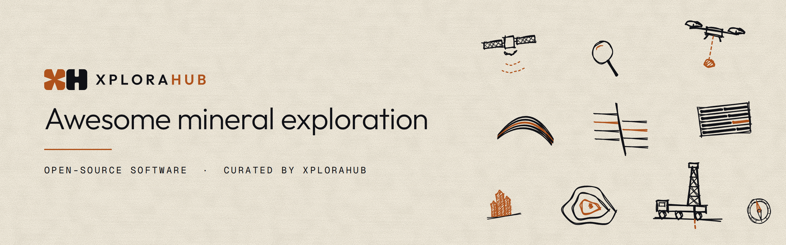

# Awesome mineral exploration

> Open-source software for finding what lies beneath.

A curated list of open-source software for mineral exploration: geophysics, geological modelling, drillholes, geostatistics, geochemistry, remote sensing and prospectivity mapping.

Every tool here is open source, has a licence and has been updated in the last 18 months. Curated by [XploraHub](https://xplorahub.com), open ground for exploration & mining technology.

## Contents

- [Geophysics](#geophysics)
- [Geological modelling and structural geology](#geological-modelling-and-structural-geology)
- [Drillholes and logging](#drillholes-and-logging)
- [Geostatistics and resource estimation](#geostatistics-and-resource-estimation)
- [Geochemistry](#geochemistry)
- [Remote sensing](#remote-sensing)
- [Prospectivity mapping and machine learning](#prospectivity-mapping-and-machine-learning)
- [Geological data](#geological-data)
- [GIS and 3D visualisation](#gis-and-3d-visualisation)
- [Related lists](#related-lists)

## Geophysics

How the methods work: [magnetics, gravity, ERT, IP, MT and more](https://xplorahub.com/methods).

- [SimPEG](https://github.com/simpeg/simpeg) – Forward modelling and inversion for gravity, magnetics, DC resistivity, IP and electromagnetics. Python, MIT.
- [discretize](https://github.com/simpeg/discretize) – Meshes and finite-volume tools behind SimPEG. Python, MIT.
- [geoapps](https://github.com/MiraGeoscience/geoapps) – Notebook apps for exploration inversion and interpretation, built on SimPEG. Python, MIT.
- [geoh5py](https://github.com/MiraGeoscience/geoh5py) – Python API for geoh5, an open file format for geoscience data. Python, LGPL-3.0.
- [Tomofast-x](https://github.com/TOMOFAST/Tomofast-x) – Parallel 3D inversion, including joint gravity and magnetic inversion. Fortran, MIT.
- [PyGMI](https://github.com/Patrick-Cole/pygmi) – Processing, modelling and interpretation of potential-field and radiometric data, aimed at exploration. Python, GPL-3.0.
- [pyGIMLi](https://github.com/gimli-org/pyGIMLi) – Modelling and inversion library, widely used for ERT and IP. Python, Apache-2.0.
- [ResIPy](https://gitlab.com/hkex/resipy) – Graphical interface and Python API for processing and inverting resistivity and IP surveys. Python, GPL-3.0.
- [Harmonica](https://github.com/fatiando/harmonica) – Processing, forward modelling and inversion of gravity and magnetic data. Python, BSD-3-Clause.
- [Verde](https://github.com/fatiando/verde) – Gridding and processing of spatial data such as ground and airborne survey lines. Python, BSD-3-Clause.
- [Boule](https://github.com/fatiando/boule) – Reference ellipsoids and normal gravity for gravity processing. Python, BSD-3-Clause.
- [Choclo](https://github.com/fatiando/choclo) – Forward-modelling kernels for gravity and magnetic sources. Python, BSD-3-Clause.
- [MTpy-v2](https://github.com/MTgeophysics/mtpy-v2) – Tools for magnetotelluric transfer functions, built on MTH5. Python, MIT.
- [emg3d](https://github.com/emsig/emg3d) – 3D electromagnetic modelling with a multigrid solver. Python, Apache-2.0.
- [empymod](https://github.com/emsig/empymod) – Electromagnetic modelling for layered (1D) earth models. Python, Apache-2.0.
- [GA-AEM](https://github.com/GeoscienceAustralia/ga-aem) – Modelling and 1D inversion of airborne electromagnetic data, from Geoscience Australia. C++, GPL-2.0.
- [segyio](https://github.com/equinor/segyio) – Fast reading and writing of SEG-Y seismic files. C and Python, LGPL-3.0.
- [OpendTect](https://github.com/OpendTect/OpendTect) – Seismic interpretation software. C++, GPL-3.0.

## Geological modelling and structural geology

How the methods work: [geological modelling](https://xplorahub.com/methods/geological-modelling) and [structural geology](https://xplorahub.com/methods/structural-geology).

- [GemPy](https://github.com/gempy-project/gempy) – Implicit 3D structural geological modelling from contacts and orientations, with uncertainty. Python, EUPL-1.2.
- [GemGIS](https://github.com/cgre-aachen/gemgis) – Prepares GIS and spatial data for geological modelling with GemPy. Python, LGPL-3.0.
- [LoopStructural](https://github.com/Loop3D/LoopStructural) – 3D structural geological modelling library, including folds and faults. Python, MIT.
- [geoML](https://github.com/italo-goncalves/geoML) – Gaussian-process spatial modelling, including implicit geological models. Python, GPL-3.0.
- [APSG](https://github.com/ondrolexa/apsg) – Structural geology and fabric analysis. Python, MIT.
- [mplstereonet](https://github.com/joferkington/mplstereonet) – Stereonets for structural data in matplotlib. Python, MIT.

## Drillholes and logging

How the methods work: [diamond and RC drilling](https://xplorahub.com/methods/diamond-and-rc-drilling), [core logging](https://xplorahub.com/methods/core-logging-and-scanning) and [downhole geophysics](https://xplorahub.com/methods/downhole-geophysics).

- [GeoStrix](https://github.com/Matt-Mendes-ai/geostrix) – Lightweight 3D software for drillholes, geochemistry, geophysics, modelling and drill planning. MIT. [XploraHub page](https://xplorahub.com/products/geostrix).
- [lasio](https://github.com/kinverarity1/lasio) – Read and write Log ASCII Standard (LAS) files for downhole logs. Python, MIT.
- [omfvista](https://github.com/pyvista/omfvista) – Loads Open Mining Format (OMF) files into PyVista for 3D viewing. Python, BSD-3-Clause.

## Geostatistics and resource estimation

How the method works: [geostatistics](https://xplorahub.com/methods/geostatistics).

- [GeostatsPy](https://github.com/GeostatsGuy/GeostatsPy) – Geostatistics in Python, started as a reimplementation of GSLIB. Python, MIT.
- [GSTools](https://github.com/GeoStat-Framework/GSTools) – Variograms, kriging and random field simulation. Python, LGPL-3.0.
- [PyKrige](https://github.com/GeoStat-Framework/PyKrige) – Ordinary and universal kriging in 2D and 3D. Python, BSD-3-Clause.
- [scikit-gstat](https://github.com/mmaelicke/scikit-gstat) – Variogram estimation and modelling. Python, MIT.
- [GStatSim](https://github.com/GatorGlaciology/GStatSim) – Sequential Gaussian simulation and kriging. Python, MIT.
- [pyinterpolate](https://github.com/DataverseLabs/pyinterpolate) – Kriging, Poisson kriging and variogram analysis. Python, BSD.

## Geochemistry

- [pyrolite](https://github.com/morganjwilliams/pyrolite) – Processing, normalisation and plotting of geochemical data. Python, MIT.

## Remote sensing

- [hylite](https://github.com/hifexplo/hylite) – Hyperspectral data for geology, including drill-core, outcrop and airborne scans. Python, MIT.
- [EnMAP-Box](https://github.com/EnMAP-Box/enmap-box) – QGIS plugin for processing and analysing hyperspectral imagery. Python, GPL-3.0.
- [Spectral Python (SPy)](https://github.com/spectralpython/spectral) – Reading, processing and classifying hyperspectral imagery. Python, MIT.

## Prospectivity mapping and machine learning

Background: [AI in mining](https://xplorahub.com/guides/ai-in-mining).

- [EIS Toolkit](https://github.com/GispoCoding/eis_toolkit) – Mineral prospectivity mapping library from the EU Exploration Information System project. Python, EUPL-1.2.
- [uncover-ml](https://github.com/GeoscienceAustralia/uncover-ml) – Machine learning for geoscience mapping, from Geoscience Australia's UNCOVER programme. Python, Apache-2.0.
- [pulearn](https://github.com/pulearn/pulearn) – Positive-unlabelled learning, suited to prospectivity where only known deposits are labelled. Python, BSD-3-Clause.
- [elapid](https://github.com/earth-chris/elapid) – MaxEnt and other presence-only models, used for prospectivity as well as species mapping. Python, MIT.

## Geological data

- [Macrostrat](https://github.com/UW-Macrostrat/macrostrat) – Platform for integrating geological maps, stratigraphy and literature. Apache-2.0.

## GIS and 3D visualisation

- [QGIS](https://github.com/qgis/QGIS) – Desktop GIS for maps, tenements and survey data. C++ and Python, GPL-2.0.
- [GeoPandas](https://github.com/geopandas/geopandas) – Vector geospatial data in Python. BSD-3-Clause.
- [Rasterio](https://github.com/rasterio/rasterio) – Reading and writing raster data such as grids and imagery. Python, BSD-3-Clause.
- [rioxarray](https://github.com/vylor/rioxarray) – Rasterio for xarray, for gridded survey data with coordinates. Python, Apache-2.0.
- [PyGMT](https://github.com/GenericMappingTools/pygmt) – Publication-quality maps and figures with the Generic Mapping Tools. Python, BSD-3-Clause.
- [PyVista](https://github.com/pyvista/pyvista) – 3D visualisation and mesh analysis, used by several tools above. Python, MIT.

## Related lists

- [Awesome Open Geoscience](https://github.com/softwareunderground/awesome-open-geoscience) – Open-source geoscience software across every field.
- [Awesome Mining Data](https://github.com/Arpeggeo/awesome-mining-data) – Open datasets for the mining industry.
- [Awesome Mining Band Ratio](https://github.com/rodreras/awesome-mining-band-ratio) – Band ratios and mineral spectra for exploration.

## Contributing

To add a tool, open a pull request with one line in the right section. Tools listed on XploraHub carry a link to their XploraHub page after the licence. See [CONTRIBUTING.md](CONTRIBUTING.md) for the rules. Everyone taking part agrees to the [code of conduct](CODE_OF_CONDUCT.md).

## Licence

This list is released under CC0 1.0. The tools listed keep their own licences.
